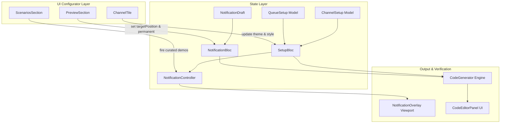

# NFQ Studio: v0.5.0 Integration & Modernization Plan

> **Target Version**: `flutter_notification_queue` v0.5.0  
> **Target Component**: `example/` (NFQ Studio Web & Desktop Showcase)  
> **Status**: Preserved Architecture & Integration Plan  
> **Related Documents**: [`doc/migration_v0_5.md`](file:///home/ono/Projects/flutter_notification_queue/doc/migration_v0_5.md), [`doc/planning/theme_token_architecture_spec.md`](file:///home/ono/Projects/flutter_notification_queue/doc/planning/theme_token_architecture_spec.md), [`example/GUIDELINES.md`](file:///home/ono/Projects/flutter_notification_queue/example/GUIDELINES.md)

---

## 1. Executive Summary & Purpose

The **NFQ Studio** ([`example/`](file:///home/ono/Projects/flutter_notification_queue/example)) serves as the official reference implementation, interactive visual playground, and code synthesis engine for `flutter_notification_queue`.

With the completion of the core v0.5.0 foundational upgrades in the library:
1. **Theme Token Architecture**: Migration from loose scalar colors to cohesive [`NotificationThemeData`](file:///home/ono/Projects/flutter_notification_queue/lib/src/theme/notification_theme_data.dart) (`ThemeExtension`).
2. **Archetype Overrides**: Channel-level and notification-level overrides of structural card styles ([`FilledQueueStyle`](file:///home/ono/Projects/flutter_notification_queue/lib/src/queue_style/filled_queue_style.dart), [`OutlinedQueueStyle`](file:///home/ono/Projects/flutter_notification_queue/lib/src/queue_style/outlined_queue_style.dart), [`FlatQueueStyle`](file:///home/ono/Projects/flutter_notification_queue/lib/src/queue_style/flat_queue_style.dart)).
3. **Dispatch-Time Positioning**: Routing placement dynamically via `controller.show(..., targetPosition:)` rather than hardcoding coordinates on data payloads.
4. **Clean Deprecation Windows**: Purging deprecated parameters (`initialIsPinned`, `dragBehavior` on payloads, loose scalar colors) in favor of standard library patterns (`permanent: true`, queue-level physics).

This specification outlines the systematic integration of these enhancements into the NFQ Studio example app.

---

## 2. Triple Purpose of the Example App

```
┌────────────────────────────────────────────────────────────────────────┐
│                          NFQ Studio (example/)                         │
├─────────────────────────┬──────────────────────┬───────────────────────┤
│   1. Reference Arch     │  2. Interactive Lab  │  3. Code Synthesis    │
│                         │                      │                       │
│  • Clean BLoC pattern   │  • Live 9-queue map  │  • 100% deprecation-  │
│  • Strict 3-tier rules  │  • Theme token tests │    free code output   │
│  • Zero compiler lints  │  • One-click demos   │  • Copy-paste ready   │
│  • Model immutability   │  • Edge-case verify  │  • Idiomatic Dart     │
└─────────────────────────┴──────────────────────┴───────────────────────┘
```

1. **The Reference Implementation**: The first codebase prospective adopters inspect. It must exemplify standard library architecture: strict separation of concerns, immutable models, and zero deprecated usages.
2. **Interactive Developer Studio**: A live sandbox enabling developers to test layout geometries, responsive behavior, dark/light theme switching, and gesture physics in real time.
3. **Copy-Paste Code Generator**: A code synthesis engine that outputs production-grade Dart code matching the user's active studio configuration.

---

## 3. Architecture & Data Flow



---

## 4. Phase-by-Phase Integration Plan

### Phase 1: Models & BLoC Modernization

#### 1.1 `ChannelSetup` Model ([`example/lib/studio/models/channel_setup.dart`](file:///home/ono/Projects/flutter_notification_queue/example/lib/studio/models/channel_setup.dart))
* **Theme Token Packaging**:
  * Replace the loose scalar color arguments (`defaultColor`, `defaultForegroundColor`, `defaultBackgroundColor`) in `toNotificationChannel()` with unified [`NotificationThemeData`](file:///home/ono/Projects/flutter_notification_queue/lib/src/theme/notification_theme_data.dart):
    ```dart
    NotificationChannel(
      name: name,
      description: description,
      theme: hasCustomColors
          ? NotificationThemeData(
              accentColor: color,
              foregroundColor: foregroundColor,
              backgroundColor: backgroundColor,
            )
          : null,
      style: _resolveArchetypeStyle(styleType),
      position: position,
      defaultDismissDuration: ...,
      defaultIcon: iconPreset.toWidget(),
      enabled: enabled,
    )
    ```
* **Archetype Style Override**:
  * Add `final Type? styleType;` ([`FilledQueueStyle`](file:///home/ono/Projects/flutter_notification_queue/lib/src/queue_style/filled_queue_style.dart), [`OutlinedQueueStyle`](file:///home/ono/Projects/flutter_notification_queue/lib/src/queue_style/outlined_queue_style.dart), [`FlatQueueStyle`](file:///home/ono/Projects/flutter_notification_queue/lib/src/queue_style/flat_queue_style.dart), or `null` for queue default).
  * Expose `styleType` in `copyWith`, `props`, and serialization.

#### 1.2 `NotificationDraft` & `NotificationBloc` ([`example/lib/studio/bloc/notification_bloc.dart`](file:///home/ono/Projects/flutter_notification_queue/example/lib/studio/bloc/notification_bloc.dart))
* **State Hygiene**:
  * Transition `initialIsPinned` on `NotificationDraft` to `final bool permanent;` (keeping backward-compatible getter during migration).
  * Provide explicit `positionOverride` / `targetPosition` semantics for dispatch-time routing.
* **Dispatch Routing**:
  * In `_onFirePreview`, route via `targetPosition`:
    ```dart
    setupBloc.controller.show(
      AppNotification(
        title: draft.title,
        message: draft.message,
        channelName: draft.channelName,
        priority: draft.priority,
        permanent: draft.permanent,
        action: action,
        tapBehavior: tapBehavior,
        dismissDuration: draft.dismissSeconds != null
            ? Duration(seconds: draft.dismissSeconds!)
            : null,
      ),
      targetPosition: draft.positionOverride, // Modern v0.5.0 routing
    );
    ```
  * Stop passing deprecated `position:`, `dragBehavior:`, and `initialIsPinned:` to [`AppNotification`](file:///home/ono/Projects/flutter_notification_queue/lib/src/models/app_notification.dart).

---

### Phase 2: UI Configurator Enhancements

#### 2.1 `ChannelTile` ([`example/lib/studio/panels/configurator/channel_tile.dart`](file:///home/ono/Projects/flutter_notification_queue/example/lib/studio/panels/configurator/channel_tile.dart))
* **Style Archetype Dropdown**:
  * Add a selector allowing each channel to choose:
    * `Default (Follow Queue)`
    * `Filled Card (FilledQueueStyle)`
    * `Outlined Card (OutlinedQueueStyle)`
    * `Flat Indicator (FlatQueueStyle)`
* **Theme Token Packaging**:
  * Present Primary, Foreground, and Background colors as the channel's `Theme Palette (NotificationThemeData)`.
  * Expose clear token labels: Accent/Primary, Foreground, and Background.

#### 2.2 `PreviewSection` ([`example/lib/studio/panels/configurator/preview_section.dart`](file:///home/ono/Projects/flutter_notification_queue/example/lib/studio/panels/configurator/preview_section.dart))
* **Label & Tooltip Modernization**:
  * Update `"POSITION OVERRIDE"` $\rightarrow$ `"DISPATCH TARGET POSITION (targetPosition)"` with help text explaining that this overrides channel placement at dispatch time.
  * Update `"PIN INITIALLY"` $\rightarrow$ `"PERMANENT (STAYS UNTIL DISMISSED)"` wired to `UpdatePermanent(permanent: v)`.
  * Remove deprecated per-notification drag behavior override dropdown.

#### 2.3 `ScenariosSection` ([`example/lib/studio/panels/configurator/scenarios_section.dart`](file:///home/ono/Projects/flutter_notification_queue/example/lib/studio/panels/configurator/scenarios_section.dart))
* **Purge Deprecated Calls**:
  * Update existing scenarios (`Pinned Critical Alert`, `Meeting in 15 Minutes`, `Sticky Alert`) to use `permanent: true`, action buttons, and queue-level physics.
* **Add New v0.5.0 Showcase Demos**:
  1. **Dynamic Theme Palette**: Demonstrates `NotificationThemeData.fromSeed` dynamically adapting to themes.
  2. **Channel Archetype Override**: Demonstrates a channel configured with `FilledQueueStyle` rendering inside an `OutlinedQueueStyle` queue.
  3. **Contextual Dispatch (`targetPosition`)**: Fires a notification that dynamically overrides its channel's position to a different screen corner via `controller.show(..., targetPosition:)`.

---

### Phase 3: Code Generator Modernization ([`example/lib/studio/engine/code_generator.dart`](file:///home/ono/Projects/flutter_notification_queue/example/lib/studio/engine/code_generator.dart))

Update code generation logic to output **zero deprecated symbols**:

#### Generated Channel Output:
```dart
NotificationChannel(
  name: 'billing',
  theme: const NotificationThemeData(
    accentColor: Color(0xFF6366F1),
    backgroundColor: Color(0xFF1E1B4B),
    foregroundColor: Color(0xFFEEF2FF),
  ),
  style: const FilledQueueStyle(), // Channel archetype override
)
```

#### Generated Notification Dispatch Output:
```dart
controller.show(
  AppNotification(
    title: 'Order Confirmed',
    message: 'Your invoice has been processed.',
    channelName: 'billing',
    permanent: false,
    action: NotificationAction.button(
      label: 'VIEW INVOICE',
      onPressed: () {},
    ),
  ),
  targetPosition: QueuePosition.bottomRight, // Contextual dispatch routing
);
```

---

### Phase 4: Test Suite & Verification

1. **Unit & Widget Tests ([`example/test/studio_test.dart`](file:///home/ono/Projects/flutter_notification_queue/example/test/studio_test.dart))**:
   * Add test verifying `ChannelSetup.toNotificationChannel()` maps `NotificationThemeData` and `QueueStyle` correctly.
   * Update `CodeGenerator` tests to assert zero deprecated parameters and verify `targetPosition:` and `permanent: true` output.
   * Verify preview trigger dispatches with `targetPosition`.
2. **Quality Checks**:
   * `dart analyze example/` $\rightarrow$ 0 warnings, 0 lints.
   * `flutter test` in `example/` $\rightarrow$ 100% green.
   * `flutter test` at root $\rightarrow$ 100% green.

---

## 5. Implementation Task Matrix

| Step | Component | Status | Details |
|---|---|---|---|
| **Step 1** | `models/channel_setup.dart` | 🟢 Complete | Added `styleType`, mapped `theme: NotificationThemeData(...)`, removed deprecated loose color args |
| **Step 2** | `bloc/notification_bloc.dart` | 🟢 Complete | Added `permanent: bool`, route `targetPosition` via `controller.show()`, compat getter for `initialIsPinned` |
| **Step 3** | `engine/code_generator.dart` | 🟢 Complete | Generates `NotificationThemeData`, `style`, `targetPosition`, and `permanent: true` with zero deprecations |
| **Step 4** | `panels/configurator/channel_tile.dart` | 🟢 Complete | Added archetype dropdown & theme token controls with palette labels |
| **Step 5** | `panels/configurator/preview_section.dart` | 🟢 Complete | Modernized labels (`targetPosition`, `permanent: true`) and removed deprecated payload drag controls |
| **Step 6** | `panels/configurator/scenarios_section.dart` | 🟢 Complete | Modernized scenarios and added v0.5.0 showcase demos (`fromSeed`, dynamic `targetPosition`) |
| **Step 7** | `example/test/studio_test.dart` | 🟢 Complete | Added tests for `ChannelSetup` mapping and updated code generator assertions |
| **Step 8** | CI & Static Analysis | 🟢 Complete | Zero warnings/lints (`dart analyze`) and 100% tests passing (`flutter test` across all targets) |
