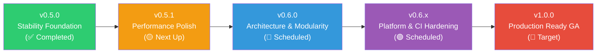

# FNQ Unified Development Roadmap & Tracking Board

> **Current Version**: 0.5.0  
> **Strategic Focus**: Code Quality, Performance, Resource Safety & Architecture Hardening towards v1.0.  
> **Baseline Quality**: `dart analyze` — 0 issues | `flutter test` — 231/231 passing.

---

## 🧭 Strategic Release Tracks



| Release | Focus / Theme | Status | Key Deliverables |
|---|---|---|---|
| **v0.5.0** | **Stability Foundation** | ✅ Completed | Snooze timer cleanup, idempotent disposal, error handler chaining, single source-of-truth pinning, golden test tolerance. |
| **v0.5.1** | **Performance Polish** | 📅 Next Up | O(1) notification lookups, memoized item partitioning, lazy queue evaluations, `PlatformDispatcher.implicitView` modernizations. |
| **v0.6.0** | **Architecture & Encapsulation** | 📅 Scheduled | Decompose `notification.dart` monolith, extract theme & interaction modules, DRY coordinator resolution mixin, configuration immutability. |
| **v0.6.x** | **Platform & CI Hardening** | 📅 Scheduled | Accessibility / FocusNode traversal, desktop right-click context menu, CI golden matrix, documentation audits. |
| **v1.0.0** | **Production GA** | 🎯 Target | Public API freeze, 100% test coverage on critical paths, full multi-window support, zero memory leaks. |

---

## 📊 Status Board & Complexity Matrix

```
Priority Tiers:
🔴 P0 (Critical) : Eliminates crash vectors, resource leaks, or correctness bugs.
🟡 P1 (High)     : High-impact performance optimizations and architectural guardrails.
🟢 P2 (Medium)   : Code quality improvements, ergonomics, and accessibility enhancements.
🔵 P3 (Low)      : Edge-case optimizations and cosmetic styling refinements.

Complexity Tiers:
🟢 Low    : Localized parameter adjustments, documentation, or basic unit tests.
🟡 Medium : State machine updates, lifecycle coordination, caching, or data model changes.
🔴 High   : Cross-subsystem refactorings, multi-file monolith decomposition, or layout pipeline shifts.
```

---

## 📋 Comprehensive Task Tracking Boards

### Track 1: Release 0.5.0 — Stability Foundation (Completed ✅)

| ID | Task Description | Priority | Complexity | Status | Target Files |
|---|---|---|---|---|---|
| **S-01** | Track and cancel snooze timers on coordinator detach/dispose | 🔴 P0 | 🟢 Low | ✅ Completed | `lib/src/core/queue_coordinator.dart` |
| **S-02** | Add `_isDisposed` guard & idempotent disposal to controller and coordinator | 🔴 P0 | 🟢 Low | ✅ Completed | `lib/src/core/notification_controller.dart`, `lib/src/core/queue_coordinator.dart` |
| **S-03** | Fix `FlutterError.onError` chaining (non-destructive handler preservation) | 🔴 P0 | 🟢 Low | ✅ Completed | `lib/src/core/notification_controller.dart` |
| **S-04** | Replace bare `on Object catch (_) {}` with structured contextual logging | 🟡 P1 | 🟢 Low | ✅ Completed | `lib/src/core/queue_coordinator.dart` |
| **S-05** | Unify `isPinned` state: single source-of-truth via `blueprint.isPinnedNotifier` | 🟡 P1 | 🟡 Medium | ✅ Completed | `lib/src/core/notification_entry.dart`, `lib/src/core/queue_coordinator.dart` |
| **S-06** | Add `_isDisposed` guard to snooze timer auto-requeue callback | 🟡 P1 | 🟢 Low | ✅ Completed | `lib/src/core/queue_coordinator.dart` |
| **S-07** | Regenerate goldens & configure `_TolerantGoldenComparator` (0.5% tolerance) | 🟡 P1 | 🟢 Low | ✅ Completed | `test/golden/visual_regression_test.dart` |
| **S-08** | Resolve all open `todo` blocks in source code with definitive documentation | 🟢 P2 | 🟢 Low | ✅ Completed | `lib/src/notification/app_notification.dart`, `lib/src/notification/theme/notification_theme.dart`, `lib/src/notification/notification.dart` |

---

### Track 2: Release 0.5.1 — Performance Polish (Next Up ⚡)

| ID | Task Description | Priority | Complexity | Status | Target Files |
|---|---|---|---|---|---|
| **P-01** | Implement `_activeById` index map for O(1) notification lookup by ID | 🟡 P1 | 🟡 Medium | 📅 Pending | `lib/src/core/queue_coordinator.dart` |
| **P-02** | Memoize `_partitionItems()` in queue widget; invalidate on item count changes | 🟡 P1 | 🟢 Low | 📅 Pending | `lib/src/notification_queue/queue_widget.dart` |
| **P-03** | Replace deprecated `PlatformDispatcher.implicitView` with context-aware `View.of` | 🟡 P1 | 🟢 Low | 📅 Pending | `lib/src/core/notification_overlay.dart` |
| **P-04** | Optimize `activeNotifications` getter to avoid redundant list allocations | 🟢 P2 | 🟢 Low | 📅 Pending | `lib/src/core/queue_coordinator.dart` |
| **P-05** | Lazy-evaluate `_visibleItems` instead of recomputing on every state access | 🟢 P2 | 🟢 Low | 📅 Pending | `lib/src/notification_queue/queue_widget.dart` |

---

### Track 3: Release 0.6.0 — Architecture & Encapsulation (Scheduled 🏗️)

| ID | Task Description | Priority | Complexity | Status | Target Files |
|---|---|---|---|---|---|
| **A-01** | Decompose 26-file `notification.dart` `part` monolith into distinct sub-libraries | 🟡 P1 | 🔴 High | 📅 Pending | `lib/src/notification/` |
| **A-02** | Extract `NotificationTheme` system from notification `part` into standalone library | 🟡 P1 | 🟡 Medium | 📅 Pending | `lib/src/notification/theme/notification_theme.dart` |
| **A-03** | Extract duplicate coordinator resolution into shared mixin (`CoordinatorResolver`) | 🟢 P2 | 🟢 Low | 📅 Pending | `lib/src/notification/notification.dart`, `lib/src/notification/interaction/widgets/draggable_transitions.dart`, `lib/src/notification_queue/queue_widget.dart` |
| **A-04** | Encapsulate `ConfigurationManager` fields (make private, enforce immutability) | 🟢 P2 | 🟢 Low | 📅 Pending | `lib/src/core/configuration_manager.dart` |
| **A-05** | Add `NotificationWidget? get notification` accessor to sealed `NotificationEvent` | 🟢 P2 | 🟢 Low | 📅 Pending | `lib/src/core/notification_event.dart`, `lib/src/core/history_logger.dart` |
| **A-06** | Replace static mutable `_idCounter` with instance-scoped ID generator | 🟢 P2 | 🟢 Low | 📅 Pending | `lib/src/notification/notification.dart` |

---

### Track 4: Advanced Features & Platform Perfection (F-Series)

| ID | Feature / Job Name | Phase | Priority | Complexity | Status | Target Files |
|---|---|---|---|---|---|---|
| **F-01** | Drag-to-Reorder within Queue | Phase 2 | *Critical* | 🔴 High | ✅ Completed | `lib/src/notification_queue/queue_widget.dart` |
| **F-02** | Pin-to-Edge Interaction (Pinning) | Phase 2 | *Critical* | 🟡 Medium | ✅ Completed | `lib/src/notification/notification.dart` |
| **F-03** | Desktop Parking & Runtime Config | Phase 2 | 🟢 P2 | 🟡 Medium | ✅ Completed | `lib/src/core/queue_coordinator.dart`, `lib/src/core/parking_manager.dart` |
| **F-04** | Notification Grouping (Bundling) | Phase 3 | *Critical* | 🔴 High | ✅ Completed | `lib/src/notification_queue/queue_widget.dart` |
| **F-05** | In-App History Logger & Querying | Phase 3 | 🟢 P2 | 🟡 Medium | ✅ Completed | `lib/src/core/history_logger.dart` |
| **F-06** | Focus Traversal & Accessibility | Phase 5 | 🟢 P2 | 🟢 Low | 📅 Pending | `lib/src/core/notification_overlay.dart` |
| **F-07** | Context Menu Support (Right-click) | Phase 5 | 🔵 P3 | 🟢 Low | 📅 Pending | `lib/src/notification/notification.dart` |
| **F-08** | L-Shaped Unified Corner Bars | Phase 2 | 🔵 P3 | 🟡 Medium | 📅 Pending | `lib/src/notification/interaction/overlays/dismissal_targets.dart` |
| **F-09** | Smart Layout & Overlap Avoidance | Phase 3 | *Critical* | 🔴 High | ✅ Completed | `lib/src/core/notification_overlay.dart` |
| **F-10** | Keyboard Shortcuts (`Esc` / `Shift+Esc`) | Phase 5 | *Critical* | 🟡 Medium | ✅ Completed | `lib/src/core/notification_overlay.dart` |
| **F-11** | Visual Golden Verification Suite | Phase 4 | *Critical* | 🟡 Medium | ✅ Completed | `test/golden/visual_regression_test.dart` |

---

## 🛠️ Feature & Optimization Deep Dives

### P-01: O(1) Notification ID Indexing
* **Target Release**: v0.5.1
* **Objective**: Coordinator operations like `dismiss()`, `relocate()`, `snooze()`, `pin()`, and `unpin()` currently perform linear scans across `activeNotifications` ($O(n \times m)$).
* **Implementation Plan**:
  * Introduce an internal `Map<String, NotificationEntry> _activeById` inside `QueueCoordinator`.
  * Update `_activeById` synchronously upon item enqueue, dequeue, and relocation.
  * Direct all lookup-by-ID operations directly to the map for immediate $O(1)$ resolution.

### P-02: Queue Item Partition Memoization
* **Target Release**: v0.5.1
* **Objective**: `QueueWidgetState._partitionItems()` partitions visible vs. bundled vs. pinned notifications by allocating fresh lists and sets on every build frame.
* **Implementation Plan**:
  * Store cached partition records (`_cachedPartition`).
  * Invalidate cache only when underlying queue items are added, removed, or their pinned state changes.

### A-01: Monolith Decomposition (`notification.dart`)
* **Target Release**: v0.6.0
* **Objective**: `notification.dart` currently contains 26 `part` files sharing a single flat private namespace.
* **Implementation Plan**:
  * Extract interaction plugins into dedicated library units under `lib/src/notification/interaction/`.
  * Export public plugins cleanly through `lib/src/notification/plugins.dart`.
  * Enforce clear encapsulation boundaries with `@internal` annotations where appropriate.

### F-06: Focus Traversal & Semantic Accessibility
* **Target Release**: v0.6.x
* **Objective**: Ensure notifications meet WCAG and Flutter accessibility standards.
* **Implementation Plan**:
  * Wrap notifications in semantic containers with proper accessibility labels.
  * Support keyboard tab navigation across actionable elements inside visible notifications.
  * Allow screen readers to announce incoming notifications via `SemanticsService.announce`.

---

## ✅ Completed Milestones History

| Release | Date | Highlights | Key Files Modified |
|---|---|---|---|
| **v0.5.0** | 2026-10-12 | **Stability Foundation**: Snooze timer lifecycle tracking & leak prevention; idempotent `dispose()` on `NotificationController` and `QueueCoordinator`; non-destructive `FlutterError.onError` handler chaining; single source-of-truth `isPinnedNotifier` state binding; tolerant golden comparator (0.5% threshold); resolved all source TODOs; added lifecycle & chaining test suite. | `lib/src/core/queue_coordinator.dart`, `lib/src/core/notification_controller.dart`, `lib/src/core/notification_entry.dart`, `test/golden/visual_regression_test.dart`, `test/src/core/` |
| **v0.4.1** | 2026-09-12 | **Studio Web Release Fix**: Fixed minified type name display in Studio web configurator. | `example/` |
| **v0.4.0** | 2026-08-30 | **Zero Deprecated Surface & Pure Architecture**: Complete removal of legacy static singletons (`FlutterNotificationQueue`), deprecated `FnqEvent` typedefs, and legacy action factories. Standardized 100% on `NotificationController`, `NotificationScope`, and `AppNotification`. | `lib/flutter_notification_queue.dart`, `lib/src/core/` |
| **v0.3.2** | 2026-08-26 | **Studio Web App & CI/CD Pipeline**: GitHub Pages deployment workflow (`deploy_pages.yml`), live demo badges, and mobile responsive Studio UI. | `.github/workflows/deploy_pages.yml`, `example/` |
| **v0.3.1** | 2026-08-14 | **Memory & Teardown Hardening**: Automated timer & animation ticker disposal (`ditchAllDismissTimers`), OverlayPortal detachment, and multi-tenant scope test suite. | `lib/src/core/queue_coordinator.dart`, `lib/src/notification_queue/queue_widget.dart` |
| **v0.3.0** | 2026-08-14 | **Multi-Tenant Architecture**: Introduced `NotificationController`, `NotificationScope`, `AppNotification`, sealed `NotificationEvent` hierarchy. | `lib/src/core/notification_scope.dart`, `lib/src/core/notification_controller.dart` |
| **v0.2.0** | 2026-07-19 | **Core Engine Features**: Notification Grouping (F-04), Drag-to-Reorder (F-01), Pinning (F-02), Smart Layout (F-09), Shortcuts (F-10), Visual Goldens (F-11). | `lib/src/notification_queue/`, `lib/src/notification/` |
